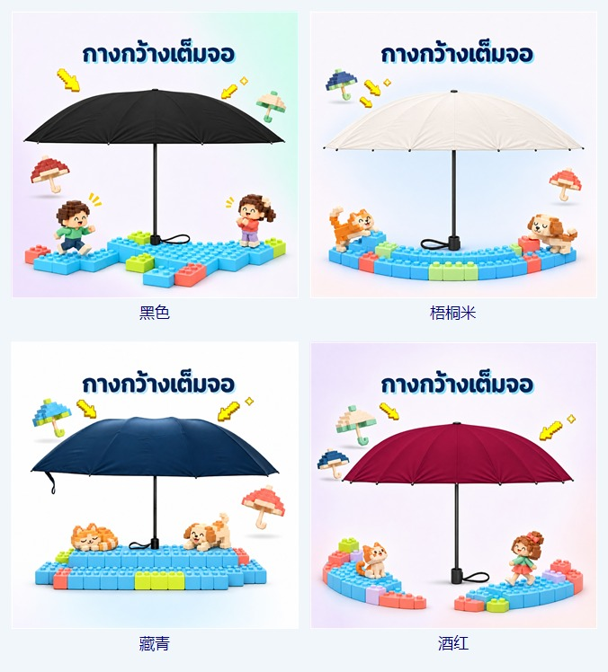
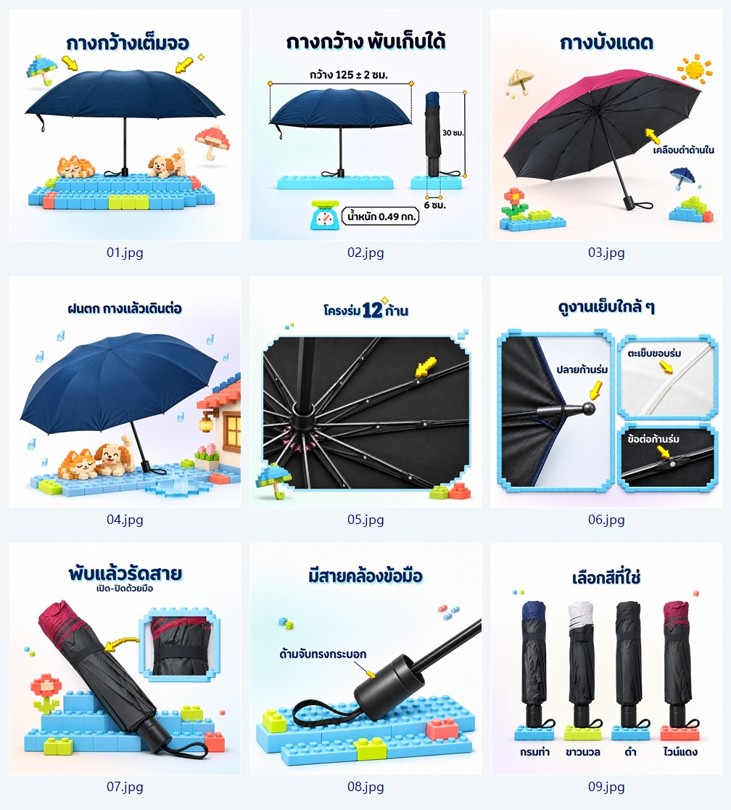

# 3D像素积木风商品图 · pixel-brick-product

让真实商品与立体像素积木一起讲卖点：有凸点的彩色舞台、原创积木公仔或猫狗、轻微渐变白底，以及清楚居中的泰文标题。



## 能做什么

- 商品首图、卖点详情、使用场景、多色套图和SKU图。
- 保持实物结构与材质，用积木角色、底座轮廓和背景位置变化丰富系列。
- 对已有图做局部修正，例如把错加皮纹的握把修回光滑表面。
- 默认导出1254×1254、真正JPEG编码的.jpg，每张严格小于2,000,000字节；尺寸按本次需求可调整。
- 附带Windows PowerShell 7导出校验和联系图脚本。

这是公开精简版：包含13张原尺寸确认样图、3张联系图和风格规则。未包含商品原始实拍、聊天记录、个人目录、账号资料或本机部署脚本。你需要为自己的商品提供真实照片和准确参数。

## 安装到Codex

方式一：在支持Skill安装的Codex中，把本仓库网址发给它，并说：

> 用 $skill-installer 安装这个仓库中 pixel-brick-product 目录下的Skill。

方式二：GitHub点Code → Download ZIP，解压后，把里面的 **pixel-brick-product** 文件夹复制到个人Skills目录。不要把外层仓库文件夹当作Skill目录。

默认目录为：
- Windows：用户主目录下的 .codex/skills/
- macOS / Linux：~/.codex/skills/
- 设置过CODEX_HOME时，以该环境配置对应的skills目录为准。

安装后在下一次对话调用；若当前界面尚未刷新列表，新开一个聊天再选择。文件夹内部应直接看见SKILL.md、agents、references、scripts和assets。

## 调用示例

> 用 $pixel-brick-product，按这些实拍给这款商品做9张泰文商品图，保持实物结构与材质，先给我九宫格审核。

> 用 $pixel-brick-product，给这个杯子做一张首图，淡桃色白底、湖蓝积木底座、左上留Logo位。

> 用 $pixel-brick-product，只修这张图的握把材质，保持开口、接缝、手绳、字体和摆位不动，给放大前后对比。

请同时给出商品照片、张数、语言和已确认的卖点。它需要当前环境具备图像生成/编辑能力；附带脚本负责导出、校验和预览，不是图像生成模型。风格规则可复用，脚本面向Windows PowerShell 7。

## 系列叙述参考



示例以雨伞为载体。图片里的尺寸、重量、颜色、结构和泰文只属于原示例商品，不能转成你自己商品的事实。其他品类按自己的卖点安排，不必照搬九张内容。

- 真实商品不被画成积木；装饰、场景和微型人物才是3D积木。
- 标题单行居中，左右Logo留白平衡。
- 每套变换底座、元素姿态、商品整体摆位和淡渐变位置。
- 商品几何、真实材质、文字和实拍一致比装饰更重要。
- 用户要求先审核时，先另存预览；批准覆盖后才备份替换。

## 文件结构

```text
README.md
LICENSE
pixel-brick-product/
  SKILL.md
  LICENSE
  agents/openai.yaml
  references/
  scripts/
  assets/
    LICENSE.md
    examples/
    contact-sheets/
    asset-index.json
```

## 许可

文字规则与脚本采用[MIT许可](LICENSE)，允许使用、修改和商用，需保留许可与版权声明。

**示例图片不适用MIT许可。** 它们只可作为风格参考、在使用本Skill时提供给图像工具，以及随完整Skill复制传播；不授权直接搬作商品上架图、单独出售或作为独立图库分发。详见[图片使用说明](pixel-brick-product/assets/LICENSE.md)。

你的新商品图片应基于你自己有权使用的照片、品牌、文字和素材制作。
